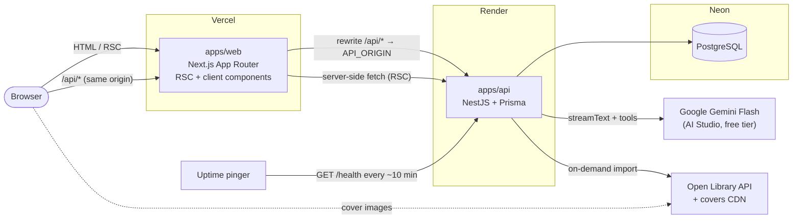
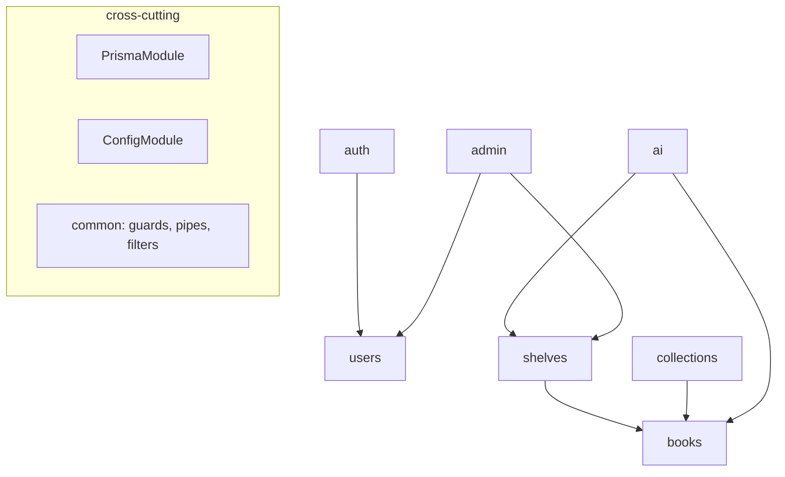
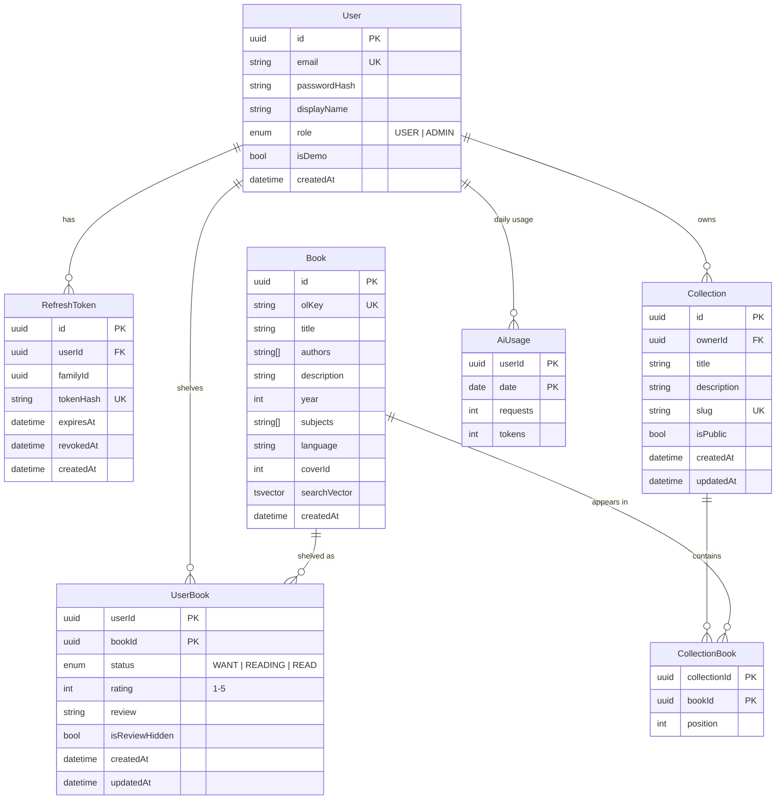
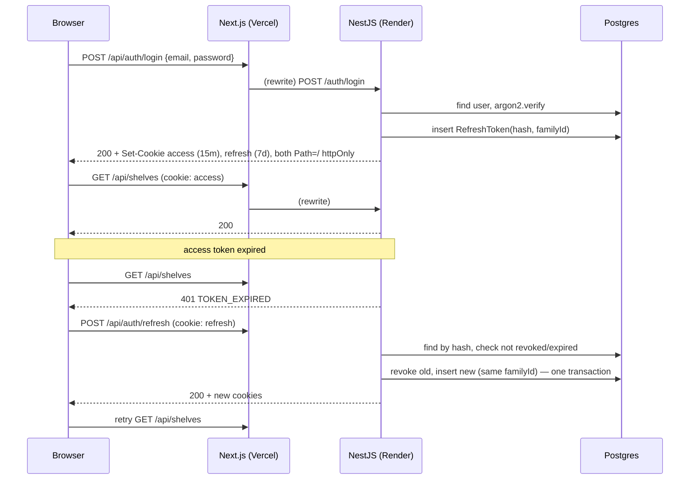
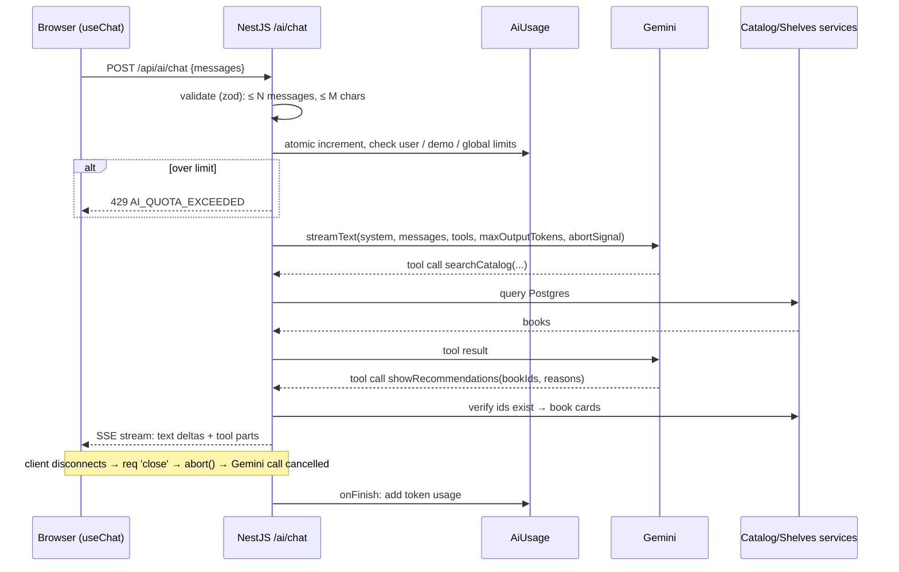

# Architecture

## System overview



- The browser only ever talks to the Vercel origin. `/api/*` is rewritten to the NestJS service, so auth cookies are first-party and no CORS is needed ([ADR-0002](adr/0002-same-origin-api-proxy.md)).
- Server Components call the API directly via `API_ORIGIN` (server-to-server), forwarding the user's cookies when the page is personalised.
- Cover images are loaded straight from `covers.openlibrary.org` (not proxied, not optimised by Vercel — saves the image-optimisation quota).

## Monorepo layout (target)

```
shelfwise/
├─ apps/
│  ├─ web/                    Next.js
│  │  ├─ app/                 routes (see modules/web.md)
│  │  ├─ components/          UI components (ui/ = primitives, feature folders)
│  │  ├─ lib/                 api client, query keys, auth helpers
│  │  └─ proxy.ts         auth gate + silent refresh (Next 16 "middleware")
│  └─ api/                    NestJS
│     ├─ src/
│     │  ├─ main.ts
│     │  ├─ app.module.ts
│     │  ├─ config/           env schema (zod), typed ConfigService
│     │  ├─ common/           exception filter, decorators, guards, cursor utils
│     │  ├─ prisma/           PrismaService
│     │  └─ modules/          auth, users, books, shelves, collections, ai, admin, health
│     ├─ prisma/
│     │  ├─ schema.prisma
│     │  ├─ migrations/
│     │  └─ seed.ts
│     ├─ scripts/fetch-openlibrary.ts
│     ├─ data/books.snapshot.json
│     └─ test/                e2e specs + test DB helpers
├─ packages/
│  └─ shared/                 zod schemas, DTO types, enums, constants
├─ docker-compose.yml         postgres (dev) + postgres (test)
├─ .github/workflows/ci.yml
├─ pnpm-workspace.yaml
├─ tsconfig.base.json
└─ .env.example
```

Module specs: [docs/modules/](modules/README.md).

## Backend module graph



Rules:
- A module exposes a service for other modules; controllers never call another module's repository/Prisma directly.
- No circular imports. `auth` depends on `users`, never the reverse.
- Guards (`JwtAuthGuard` global, `@Public()` opt-out, `RolesGuard` + `@Roles()`) live in `common/`.

## Data model



**Additions to the original spec** (small, each justified):
- `User.isDemo` — demo account gets its own quotas and can be reset.
- `RefreshToken.familyId`, `createdAt` — enables reuse detection: a reused (already rotated) token revokes its whole family ([ADR-0003](adr/0003-auth-jwt-refresh-rotation.md)).
- `Book.createdAt`, `UserBook.createdAt`, `Collection.updatedAt` — needed for "newest" sorting and stable cursors.
- `AiIpUsage` (ipHash + date PK, requests) — per-IP daily AI cap for the shared demo account; IPs stored salted-hashed ([modules/ai.md](modules/ai.md)).

**Indexes** (designed for actual queries):

| Table | Index | Serves |
|-------|-------|--------|
| Book | `GIN(searchVector)` | full-text search |
| Book | `GIN(subjects)` | subject filter (`subjects @> ARRAY[...]`) |
| Book | `btree(year)`, `btree(language)` | filters |
| Book | `btree(title, id)`, `btree(createdAt, id)` | keyset pagination by sort |
| UserBook | PK `(userId, bookId)` | upsert, "is this on my shelf" |
| UserBook | `btree(userId, status, updatedAt)` | profile shelves |
| UserBook | `btree(bookId, updatedAt)` | book page reviews + average rating |
| RefreshToken | `unique(tokenHash)`, `btree(userId)`, `btree(familyId)` | refresh lookup, revoke-all |
| CollectionBook | `btree(collectionId, position)` | ordered collection view |
| Collection | `unique(slug)`, `btree(ownerId, updatedAt)` | public page, "my collections" |

`searchVector` is maintained by a Postgres **trigger** (not a generated column: `array_to_string` is not `IMMUTABLE`, so it can't be used in a generated column). Prisma models it as `Unsupported("tsvector")`; the trigger and GIN index live in a hand-written SQL migration; search goes through `$queryRaw` ([ADR-0004](adr/0004-catalog-in-postgres-fts.md)).

## Key request flows

### Login, authenticated request and silent refresh



For Server Components, `proxy.ts` performs the refresh before rendering if the access cookie is missing/expired but a refresh cookie exists; parallel requests with the same refresh cookie are covered by a 30 s reuse interval (details in [modules/web.md](modules/web.md), [ADR-0003](adr/0003-auth-jwt-refresh-rotation.md)).

### AI advisor turn



## API conventions

- **Base path:** the API itself serves routes without a prefix (`/auth/login`); the browser sees them as `/api/auth/login` via the rewrite. Next.js rewrite: `/api/:path*` → `${API_ORIGIN}/:path*`.
- **Validation:** every body/query/param goes through Nest 12's built-in `StandardSchemaValidationPipe` (`@Body({ schema })`, `@Query({ schema })`) with a Zod schema from `@shelfwise/shared`. Unknown keys are stripped.
- **Errors:** one global exception filter; shape
  ```json
  { "error": { "code": "VALIDATION_FAILED", "message": "Request validation failed", "details": [{ "path": "rating", "message": "Too big: expected number to be <=5" }] } }
  ```
  Codes are a shared enum (`packages/shared/src/errors.ts`). Status codes: 400 validation, 401 unauthenticated / `TOKEN_EXPIRED`, 403 forbidden, 404, 409 conflict (e.g. email taken), 429 rate/quota, 502 upstream (Open Library / Gemini) failure, 500 otherwise (message hidden, logged with request id).
- **Pagination:** cursor-based everywhere ([ADR-0005](adr/0005-cursor-pagination.md)). Request `?limit=20&cursor=<opaque>`; `limit` max 50. Response `{ "items": [...], "nextCursor": "..." | null }`. Cursor = base64url JSON of the last item's sort key(s) + `id`.
- **Auth:** JWT guard global; public routes marked `@Public()`. Mutating requests require an `Origin` header matching `WEB_ORIGIN` (CSRF defence in depth on top of `SameSite=Lax`).
- **Rate limits:** `@nestjs/throttler` — strict on `/auth/*` and `/books/import`, relaxed default elsewhere. Behind Render's proxy, `trust proxy` is enabled so the client IP is correct.
- **Timeouts:** outbound HTTP (Open Library) 5s with 1 retry on idempotent GETs; Gemini calls bounded by `maxOutputTokens`, step limit and a 60s overall abort.
- **Logging:** `nestjs-pino`, JSON in prod, request id per request (also returned in `x-request-id`), cookies and `authorization` redacted.

## Configuration

- Each app validates its env with a Zod schema at startup and exits with a readable error if anything required is missing.
- Full list of variables: [external-services.md § Environment variables](external-services.md#environment-variables).

## Testing strategy

| Level | Tool | Scope |
|-------|------|-------|
| Unit | Vitest | services with branching logic: token rotation, quota checks, cursor encode/decode, slug generation, reorder, search query builder |
| E2E (API) | Vitest + Supertest + real Postgres (`shelfwise_test`) | auth flows (incl. refresh reuse), shelves CRUD + authz, collections public/private, admin RBAC, AI quota (Gemini mocked) |
| Web | Vitest + Testing Library (light) | only components with logic (optimistic shelf button, reorder list) |
| Smoke (optional) | Playwright | demo login → search → add to shelf → open collection |

The LLM is never called in tests: the AI service takes the model as an injectable dependency, and tests use the AI SDK's mock model.

## Deployment topology

| Piece | Where | Notes |
|-------|-------|-------|
| `apps/web` | Vercel (Root Directory = `apps/web`) | builds `packages/shared` via workspace; env `API_ORIGIN`, `NEXT_PUBLIC_SITE_URL` |
| `apps/api` | Render free web service | build: `pnpm install --frozen-lockfile && pnpm --filter @shelfwise/api... build`; start: `prisma migrate deploy && node dist/main.js` (free tier has no pre-deploy step) |
| DB | Neon free | pooled URL for the app (`DATABASE_URL`), direct URL for migrations (`DIRECT_URL`) |
| CI | GitHub Actions | Postgres service container for e2e |

Further reading: [ADR index](adr/README.md).
