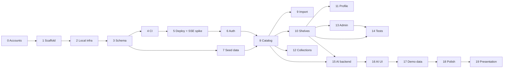

# Roadmap — step-by-step implementation plan

~3 weeks part-time (assumed ~15–20 h/week). Each step is a vertical slice that ends in a working, committed state (green CI from step 4 onwards). Order is chosen so that **risky things are verified early** (deploy, SSE through the proxy) and **the demo is presentable at the end of every week**.

Legend: 🔌 = external resource to set up in this step (details in [external-services.md](external-services.md)).

## Overview

| # | Step | Week | Depends on | 🔌 External | Est. |
|---|------|------|------------|-------------|------|
| 0 | Accounts & keys prep | 1 | — | GitHub, Neon, Render, Vercel, Google AI Studio, UptimeRobot | 1h |
| 1 | ✅ Monorepo scaffold | 1 | 0 | — | 3h |
| 2 | ✅ Local infra & config | 1 | 1 | Docker | 2h |
| 3 | ✅ Prisma schema, migrations, health | 1 | 2 | — | 3h |
| 4 | ✅ CI pipeline | 1 | 3 | GitHub Actions | 2h |
| 5 | ✅ Deploy skeleton + SSE spike + pinger | 1 | 4 | Neon, Render, Vercel, UptimeRobot | 3h |
| 6 | ✅ Auth end to end | 1 | 5 | — | 6h |
| 7 | Catalog data: fetch + snapshot + seed | 1 | 3 | Open Library API | 3h |
| 8 | Catalog search + book page | 1→2 | 6, 7 | Open Library covers CDN | 6h |
| 9 | Import from Open Library | 2 | 8 | Open Library API | 2h |
| 10 | Shelves, ratings, reviews | 2 | 8 | — | 5h |
| 11 | Profile & stats | 2 | 10 | — | 3h |
| 12 | Collections + public page + OG | 2 | 8 | — | 6h |
| 13 | Minimal admin | 2 | 10 | — | 3h |
| 14 | Test hardening (auth, shelves, RBAC) | 2 | 6–13 | — | 3h |
| 15 | AI advisor backend | 3 | 8, 10 | Google AI Studio (Gemini) | 6h |
| 16 | AI chat UI | 3 | 15 | — | 4h |
| 17 | Demo account & demo data | 3 | 10–16 | (GitHub Actions cron, optional) | 2h |
| 18 | Hardening & polish | 3 | all | (Sentry, optional) | 4h |
| 19 | Presentation | 3 | all | — | 4h |
| — | Buffer | 3 | — | — | ~5h |

**Weekly checkpoints**
- **End of week 1:** deployed skeleton with working auth and a searchable catalog on the live URL.
- **End of week 2:** full non-AI product live (shelves, profile, collections with OG, admin), tests for critical flows.
- **End of week 3:** AI advisor live with quotas, demo data, polished README.

**If time runs short, cut in this order:** step 9 (import) → admin users table (keep review moderation) → nightly demo reset → Playwright smoke → `/u/[id]` public profile. Never cut: auth, catalog, shelves, AI advisor with quotas, README.

---

## Week 1 — foundation, auth, catalog

### Step 0. Accounts & keys prep
- 🔌 Create/verify: GitHub repo (public), Neon account, Render account (connect GitHub), Vercel account (connect GitHub), Google AI Studio API key (**do not enable billing**), UptimeRobot (or cron-job.org).
- Store keys in a password manager; nothing in the repo.
- **Done when:** every account exists and you have the Gemini API key and Neon connection strings at hand.

### Step 1. Monorepo scaffold
- pnpm workspace (`pnpm-workspace.yaml`, `packageManager` field, `.nvmrc`), `tsconfig.base.json` (strict), root Prettier; ESLint (web) / oxlint (api) as generated.
- `apps/web` via `create-next-app` (App Router, TS, Tailwind, ESLint); `apps/api` via `@nestjs/cli new` (strict TS, ESM, Vitest); `packages/shared` built with `tsc` ([shared.md](modules/shared.md)).
- Wire `@shelfwise/shared` into both apps; one schema used by both to prove it works.
- Next rewrites `/api/:path*` → `API_ORIGIN`.
- **Done when:** `pnpm dev` starts web + api; web page fetches `/api/health` through the rewrite; `pnpm lint` and `pnpm typecheck` pass. Fill the Commands section of `CLAUDE.md`.

### Step 2. Local infra & config
- `docker-compose.yml` with `db` and `db-test` ([infra.md](modules/infra.md)).
- `.env.example` for api and web; Zod env validation at startup in both apps (fail fast).
- Pre-commit hooks: `simple-git-hooks` + `lint-staged` (format + lint staged files).
- API `common/`: validation via `StandardSchemaValidationPipe` + shared Zod schemas, exception filter with the error shape, `nestjs-pino` logger with request id, `helmet`, trust proxy.
- **Done when:** fresh clone → documented commands → running app; missing env var produces a clear startup error.

### Step 3. Prisma schema, migrations, health
- Full `schema.prisma` for all models in [architecture.md](architecture.md#data-model) (cheaper to design once than migrate repeatedly), including `AiIpUsage`.
- Raw SQL migration: `searchVector` trigger function + trigger + GIN indexes ([books.md](modules/books.md)).
- `PrismaService`, `health` module (`/health`, `/health/ready`).
- **Done when:** `pnpm db:migrate` on an empty DB succeeds; inserting a book fills `searchVector`; health e2e passes.

### Step 4. CI pipeline
- 🔌 GitHub Actions workflow per [infra.md § CI](modules/infra.md#ci-github-actions--githubworkflowsciyml) with a Postgres service.
- Branch protection on `develop` and `main` requiring CI; Dependabot config (PRs target `develop`).
- **Done when:** a PR shows green lint → typecheck → test → e2e → build.

### Step 5. Deploy skeleton + SSE spike + pinger
- 🔌 Neon: create project (Frankfurt), get pooled + direct URLs. Migrations are applied by the API on start.
- 🔌 Render: Blueprint from `render.yaml` (auto-deploy from `main` after green CI).
- **First release:** merge `develop → main` so Render/Vercel production have something to deploy.
- 🔌 Vercel: project with Root Directory `apps/web`, production branch `main`, `API_ORIGIN` = Render URL, `NEXT_PUBLIC_SITE_URL`.
- **SSE spike:** enable `/health/stream` temporarily; open `https://<web>.vercel.app/api/health/stream` and confirm events arrive **incrementally** for the full 60s. Record the result in [ADR-0002](adr/0002-same-origin-api-proxy.md) (if it fails → apply the fallback and write ADR-0008).
- 🔌 UptimeRobot monitor on `https://<api>.onrender.com/health`, 5–10 min interval.
- **Done when:** live web URL renders and reaches the API through `/api/*`; SSE verdict recorded; monitor is green.

### Step 6. Auth end to end
- Backend per [auth.md](modules/auth.md) + `users` basics ([users.md](modules/users.md)).
- Web: `/login`, `/register`, nav with user menu/logout, middleware silent refresh, client fetcher with single-flight refresh, landing page with "Log in as demo" ([web.md](modules/web.md)).
- Seed: admin from `ADMIN_EMAIL`/`ADMIN_PASSWORD`, demo user (`isDemo`).
- e2e tests for all auth flows (including refresh reuse detection).
- **Done when:** on the live URL: register, login, demo login, page reload keeps session, logout works; tampered/reused refresh token is rejected.
- ✅ Released in v0.2.0 and verified on the live URL (2026-11-25).
- ⏳ **Open:** confirm client-IP resolution for rate limits on production — set `ENABLE_DEBUG_ROUTES=true` on Render, compare `GET /api/health/client-ip` (through Vercel) with the real client IP, adjust `TRUST_PROXY_HOPS` if it shows a Vercel IP, then set the flag back to `false`.

### Step 7. Catalog data: fetch + snapshot + seed
- 🔌 Open Library API (no key; set a descriptive `User-Agent` with contact).
- `scripts/fetch-openlibrary.ts` → `data/books.snapshot.json` (~2–3k books, 32 curated subjects) — commit it.
- `db:seed` inserts missing books from the snapshot; runs on every production start (no shell on Render free; idempotent and insert-only).
- **Done when:** local and prod DB contain the catalog; re-running the seed is idempotent.

### Step 8. Catalog search + book page
- API: `GET /books` (FTS + filters + sorts + cursor), `/books/subjects`, `/books/:id`, `/books/:id/reviews`.
- Web: `/books` with search/filters/sort/"Load more", `/books/[id]` with cover, details, rating summary, reviews list (empty for now), `generateMetadata`, loading/empty/error states.
- 🔌 Cover images from `covers.openlibrary.org` (no key; plain ``).
- **Done when:** search "dune" returns Dune first; filters combine; pagination has no duplicates; book page is shareable with correct title/description meta.

## Week 2 — the product around the catalog

### Step 9. Import from Open Library
- `GET /books/external-search`, `POST /books/import` (auth, throttled, idempotent); web import dialog from the catalog empty state.
- **Done when:** a book missing from the catalog can be found and imported, then shelved.

### Step 10. Shelves, ratings, reviews
- API per [shelves.md](modules/shelves.md); book page `myShelf` (a separate authenticated read — the public book page is cached for everyone) and public reviews.
- Web: `ShelfButton` (optimistic), `RatingStars` (radio group), `ReviewForm`.
- **Done when:** shelf/rating/review changes appear instantly and survive reload; failure rolls back with a toast.

### Step 11. Profile & stats
- `/shelves/me/stats`, `/users/:id/profile`, `/users/:id/shelves`; pages `/me` and `/u/[id]`.
- **Done when:** profile shows tabs per status with infinite lists and correct stats.

### Step 12. Collections + public page + OG image
- API per [collections.md](modules/collections.md).
- Web: `/collections`, editor with `@dnd-kit` (mouse + keyboard) and optimistic reorder, `/c/[slug]` with `generateMetadata`, `opengraph-image.tsx` (title, owner, up to 4 covers).
- **Done when:** a public collection link pasted into a link-preview debugger (e.g. opengraph.xyz) shows the generated image; private slug → 404.

### Step 13. Minimal admin
- API per [admin.md](modules/admin.md); web `/admin/reviews`, `/admin/users`.
- **Done when:** admin hides a review and it disappears from the public book page; USER gets 403 from every admin endpoint.

### Step 14. Test hardening
- Fill gaps: e2e for auth, shelves authz, collections ownership, admin RBAC; unit tests for query builder, cursor, slug, reorder.
- **Done when:** critical flows are covered and CI is green and deterministic (run it 3×).

## Week 3 — AI advisor, demo, presentation

### Step 15. AI advisor backend
- 🔌 Google AI Studio: API key in Render env (`GOOGLE_GENERATIVE_AI_API_KEY`), confirm **no billing** is attached to the key's project; check the model's current free-tier rate limits and set `AI_GLOBAL_DAILY_REQUESTS` below the daily quota.
- Build in this order per [ai.md](modules/ai.md): quotas → model provider token + mock → tools + prompt → streaming endpoint with abort → usage endpoint → e2e with the mock model → manual prompt tuning against Gemini.
- **Done when:** curl against `/ai/chat` streams; 21st request of the day → 429; client disconnect aborts generation (visible in logs); recommendations contain only catalog ids.

### Step 16. AI chat UI
- `/advisor` per [web.md § AI chat UI](modules/web.md#ai-chat-ui): streaming text, tool states, book cards, stop, quota counter, error states, suggested prompts, privacy note.
- **Done when:** on the live URL the demo user gets streamed recommendations with clickable book cards.

### Step 17. Demo account & demo data
- Seed fixtures for the demo user: ~25 shelved books across statuses with ratings and a few reviews, 2 public collections; a couple of other seeded users with reviews so book pages aren't empty.
- Optional: 🔌 GitHub Actions `schedule` workflow → `POST /admin/demo/reset` with `CRON_SECRET` (nightly reset).
- **Done when:** "Log in as demo" lands in a profile that looks lived-in; the advisor gives personalised answers immediately.

### Step 18. Hardening & polish
- Pass over every page: loading/empty/error states, 404s, mobile at 360px, keyboard navigation, Lighthouse a11y ≥ 90.
- Logs: confirm redaction; request ids. Throttling values sanity check.
- Optional: 🔌 Sentry free tier.
- Remove/disable debug routes.
- **Done when:** checklist in [product-brief.md § Success criteria](product-brief.md#success-criteria) items 1–3, 6, 7 are true.

### Step 19. Presentation
- README: pitch, live demo link, demo login note, screenshots, chat GIF, Mermaid architecture diagram (from [architecture.md](architecture.md)), "Decisions & trade-offs" (link ADRs), local setup, tests/CI badges.
- Optional Playwright smoke test in CI.
- Update `CLAUDE.md` commands and docs to match reality.
- **Done when:** someone unfamiliar can understand the project in 5 minutes from the README and run it locally from the instructions.

---

## External resources by step (summary)

| Resource | First needed | Used for | Cost | Secret? |
|----------|--------------|----------|------|---------|
| GitHub (repo, Actions, Dependabot) | 0 / 4 | code, CI, optional cron | free (public repo) | no secrets in CI for MVP; `CRON_SECRET` + API URL if nightly reset |
| Docker Desktop (or OrbStack/Colima) | 2 | local Postgres | free | — |
| Neon | 5 | prod Postgres | free | `DATABASE_URL`, `DIRECT_URL` |
| Render | 5 | API hosting | free | env vars set in dashboard |
| Vercel | 5 | web hosting | free (Hobby) | `API_ORIGIN` |
| UptimeRobot / cron-job.org | 5 | keep API awake | free | — |
| Open Library API + covers | 7 | catalog data, covers, import | free, no key | — (contact in User-Agent) |
| Google AI Studio (Gemini Flash) | 15 | AI advisor | free tier, no billing | `GOOGLE_GENERATIVE_AI_API_KEY` |
| Sentry (optional) | 18 | error tracking | free tier | DSN |
